# Lexus Special Projects: Luxury Lounge, Off Road Kit and Mobile Showroom

Three automotive engineering projects I worked on as a **Project Engineer intern in the R&D (Special Projects) team at Autostarke Pvt Ltd**, Kerala, India (Aug 2021 to May 2022). This was also my undergraduate thesis for the B.Tech in Electronics and Communication Engineering (IoT and Sensor Networks) at VIT Vellore.

| Phase | Project | What I did |
|---|---|---|
| **I** | **MBS** — VIP lounge seat conversion on a 2021 Lexus LX570 | Led the install: transplanted OEM seat harnesses, airbags, sensors and HVAC controls into new smart seats, then diagnosed and cleared fault codes |
| **I-A** | **Project X** — budget lounge kit for Toyota Innova | Designed and prototyped the Arduino control system for lights, motors and ambient LEDs |
| **II** | **ORK** — custom off road kit for the LX570 | Material selection, CAD and stress simulation, mounting points, fabrication oversight, corrosion protection and install |
| **III** | **LMS** — truck mounted mobile showroom | Planned the power system and built and tuned a PID position control prototype for the extending side walls |

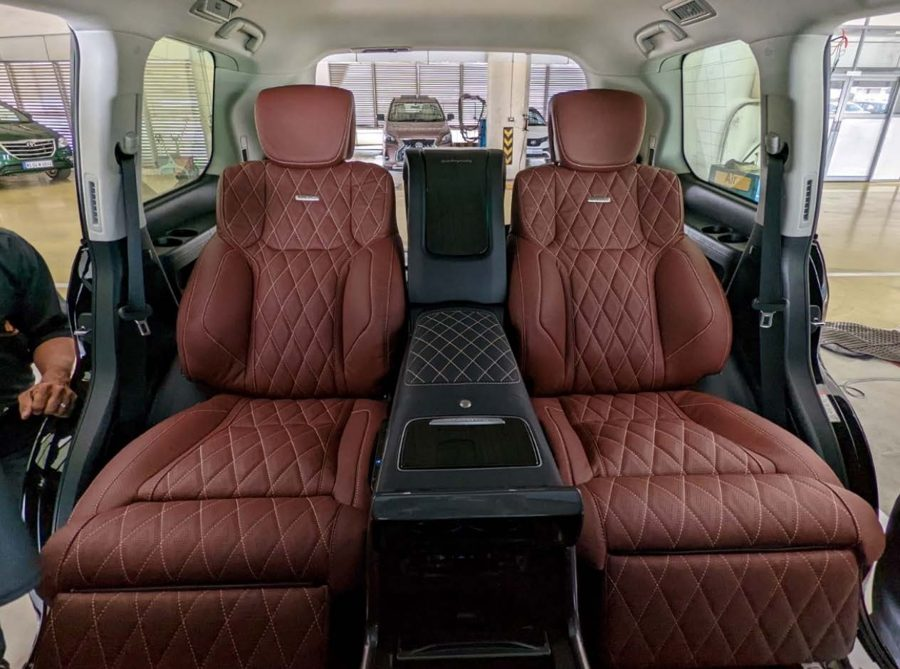 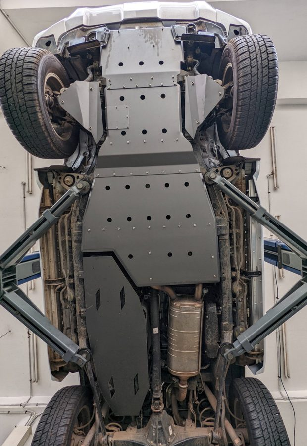 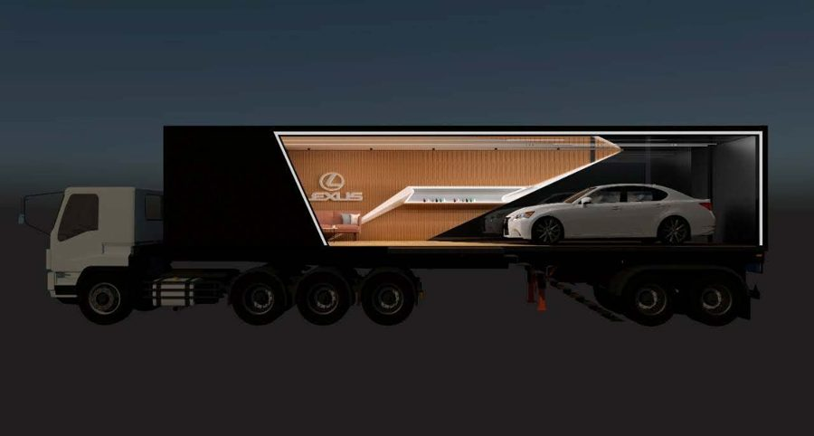

---

## Phase I: MBS luxury lounge conversion (2021 Lexus LX570)

Converted a 7 seat LX570 into a 4 seat VIP lounge with power recliner smart seats (massage, heating, ventilation, lumbar and side bolster adjustment) and a rear centre console. The hard part was **keeping every OEM function and safety system working**, since anything left disconnected throws fault codes in the vehicle ECUs.

**Subsystems moved into each new seat:** main harness, occupancy (presence) sensors, ventilation fans, heater coils with thermostat, SRS airbags, rear HVAC control panel and pneumatic massage valve blocks.

**How it went in:**
- Tapped the MBS central tunnel harness into the OEM ACC (+) line so the seats power up with the vehicle
- De-pinned and re-pinned connectors to move front seat controls, motors, fans and heaters onto the reupholstered OEM frames
- Moved the rear seat airbag, harness, presence sensor, fans, heater controls and belt latches into the new seat frames
- Moved the rear media panel ICs (HDMI, aux, headphone outputs) and the rear HVAC panel into the new console
- Scanned the vehicle with Toyota Techstream and cleared all fault codes before handover

**Problems I found and fixed:**
- **Fault code after the first scan:** traced to a loose pin on a seat heater connector (thermostat line). Re-pinned it, rescanned and cleared the code history.
- **Blown 15 A fuse:** two pins shorted on the 12 V socket connector. Found the interior fuse box behind the glove box and replaced the fuse.
- **Reversed seat adjuster:** the passenger convenience adjuster was wired inverted (likely a right hand drive variant). Swapped the pins on both sides of the piggyback connectors.

| Rewired seat base | Harness transplant | Final lounge |
|---|---|---|
| 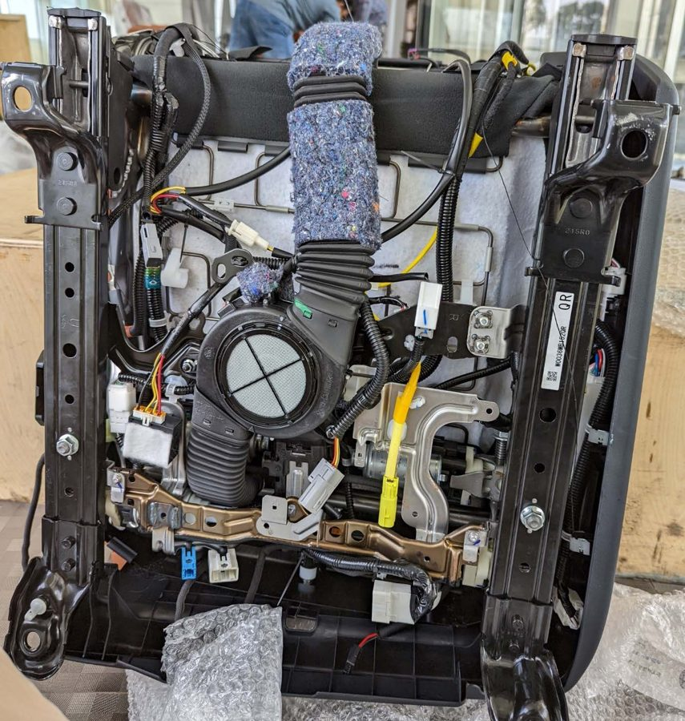 | 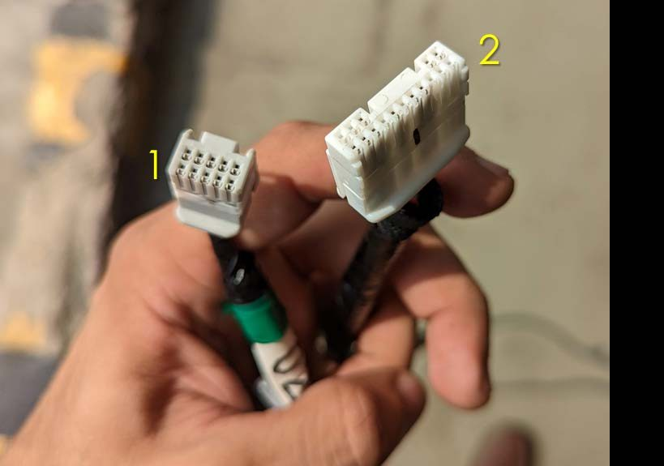 | 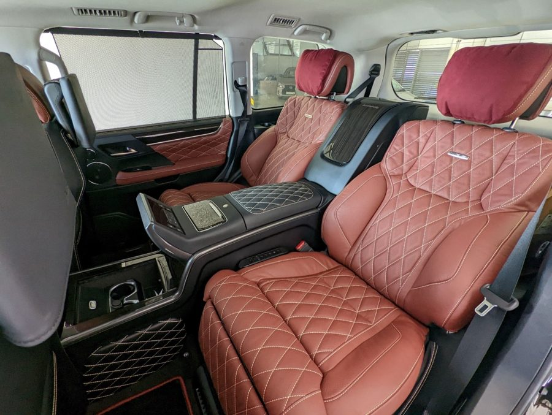 |

| Massage valve block | MBS control box | Wiring overview |
|---|---|---|
| 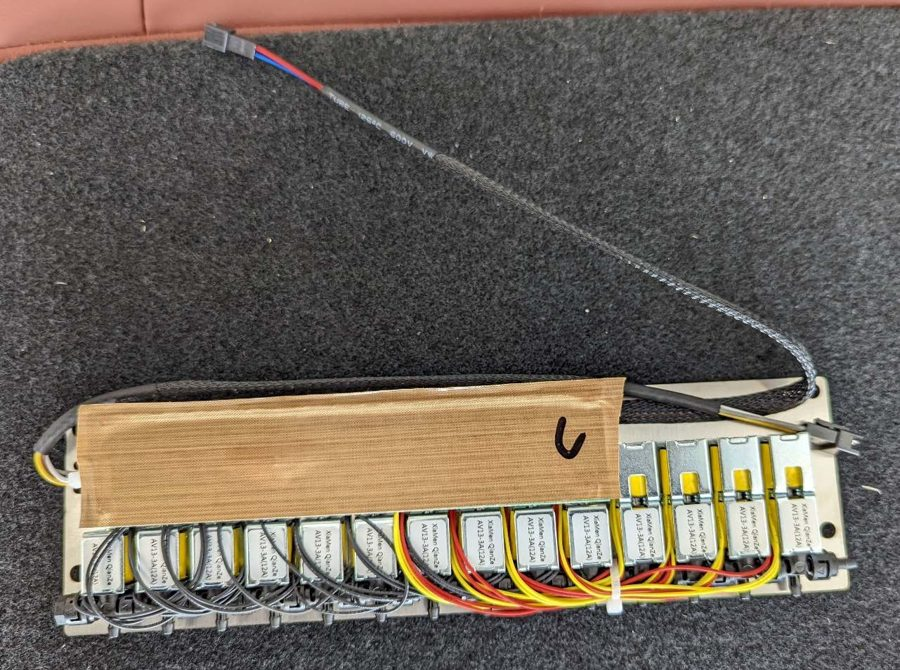 | 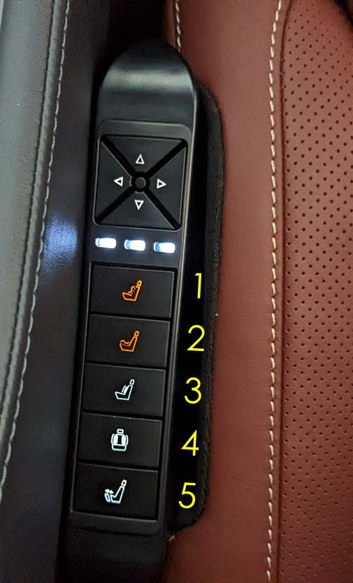 | 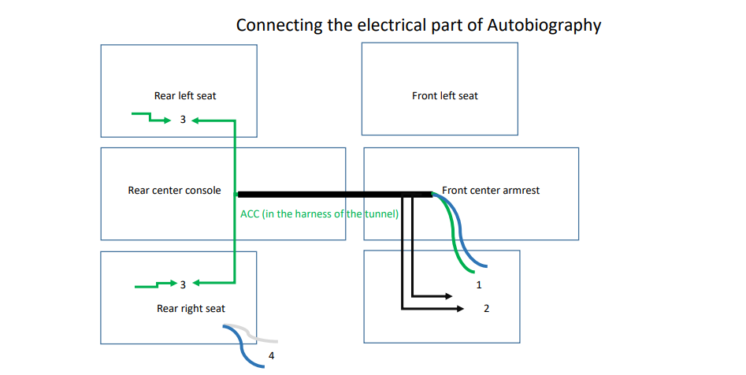 |

### Project X: budget lounge kit for the Toyota Innova

MBS taught us how the systems in a VIP lounge fit together. Project X turns that into a kit for India's most common MPV, aiming for about ₹5–10 lakh instead of a ₹2 crore luxury car. Planned features include power seats, an auxiliary battery with a DC-DC charger and inverter, a motorised privacy screen and blinds, a fridge, a coffee machine, and ambient lighting, all controlled from one Android device.

I prototyped the control system on Arduino: relay driven reading and flood lights, two motors on an H-bridge, and a NeoPixel ambient strip that fades through colours or takes a custom RGB value over Bluetooth. Code: [`firmware/px_merged_test`](firmware/px_merged_test/px_merged_test.ino)

| System block diagram | Merged test circuit (Tinkercad) |
|---|---|
| 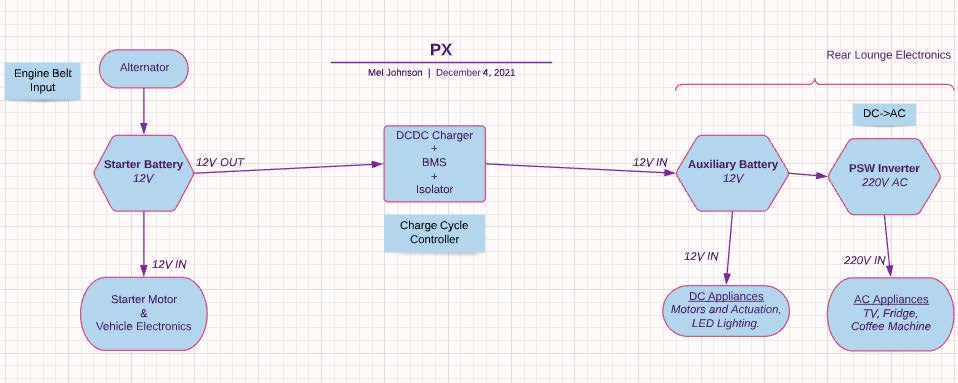 | 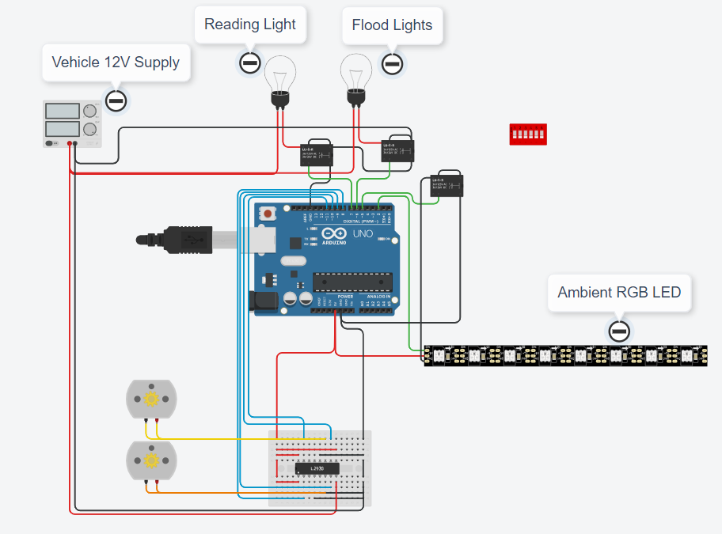 |

Each subsystem was built and tested on its own first, then merged:

| Auxiliary battery and DC-DC charger | Privacy screen and blinds motors (H-bridge) | Reading, flood and ambient lights |
|---|---|---|
| 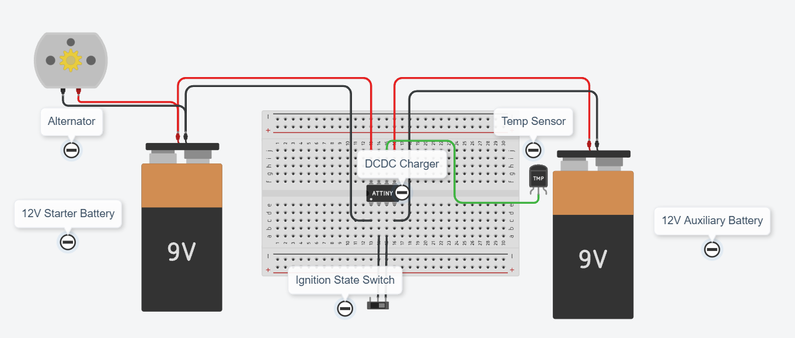 | 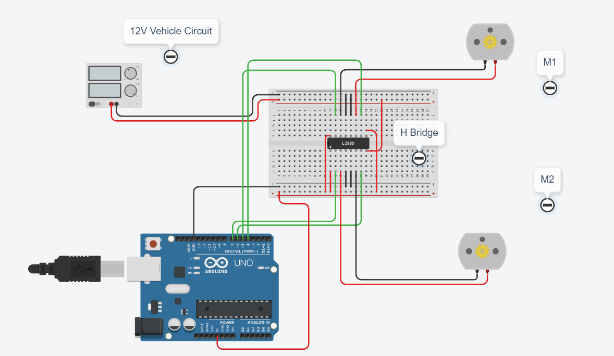 | 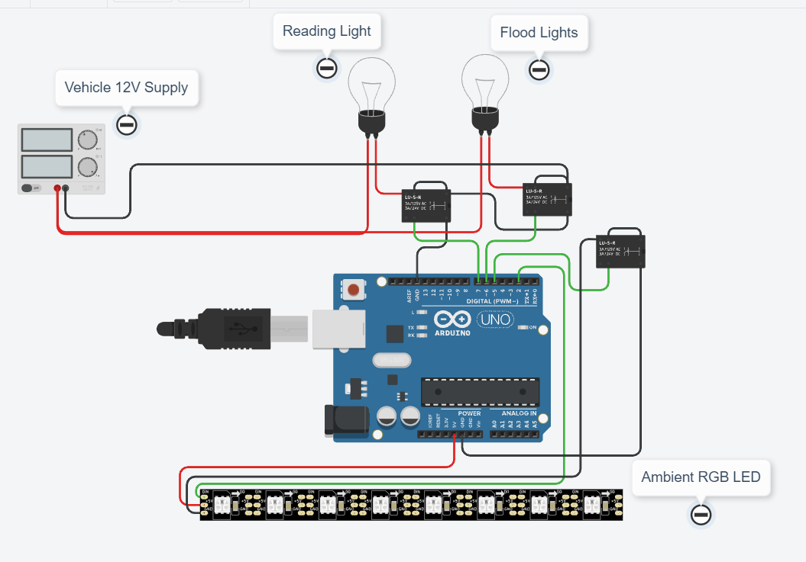 |

I also designed the interface for the Android control app: one hexagon button per cabin function, and a colour picker that sends the `#R,G,B#` command to the ambient lighting.


## Phase II: ORK off road kit (Lexus LX570)

A client used his LX570 on rough estate roads and kept damaging the underbody. He also couldn't easily reach the under chassis spare tyre. We designed, simulated, fabricated and installed:

- **6 underbody skid plates:** left and right lower arms, two engine plates, transmission (2 mm), fuel tank (2 mm)
- **Custom rear bumper (4 mm)** with better departure angle
- **Swing out spare tyre rack** with lock mechanism, mounted to the bumper and reinforced to the chassis

**Engineering choices:**
- **Material: AISI C30 carbon steel** (yield 300–400 MPa, good weldability and impact strength). I chose it over mild steel, which corrodes faster and would lose strength over time.
- **Fasteners: BUMAX 88** stainless (≥2.5% Mo) for corrosion and fatigue resistance, better than standard A4.
- **Corrosion protection:** epoxy coat, primer, paint and clear coat on every part.
- **Static stress simulation** in Fusion 360 on the bumper and rack assembly under a 5 tonne-force load, to find stress concentrations before cutting steel.
- **Drain cut-outs** in the shields so mud and debris don't collect.
- Mounted only to existing points, then checked panel gaps and road tested for **rattles and vibration**.

| CAD model | Stress simulation | Fabrication |
|---|---|---|
| 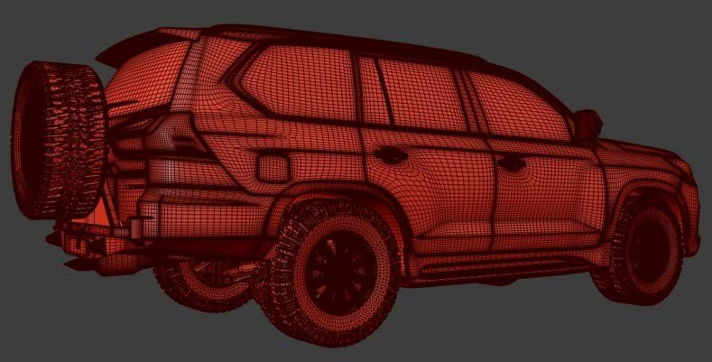 | 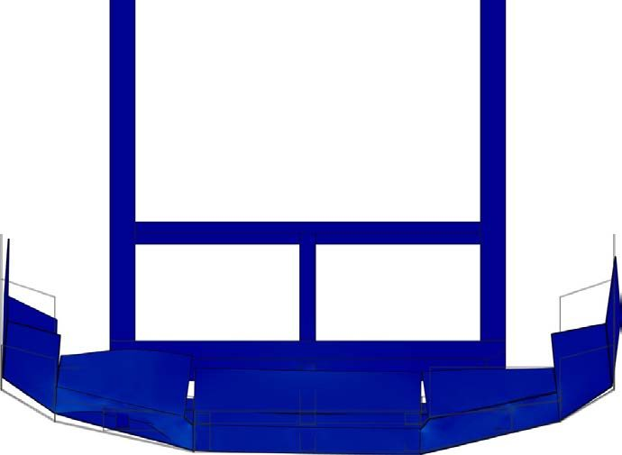 | 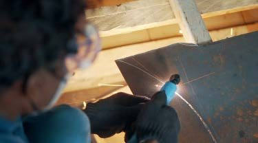 |
| **Shields painted** | **Installed underbody** | **Rear bumper and tyre rack** |
| 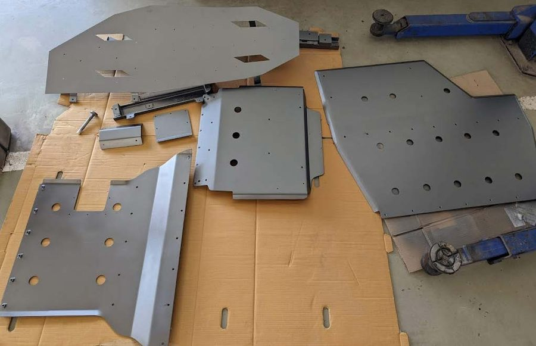 |  | 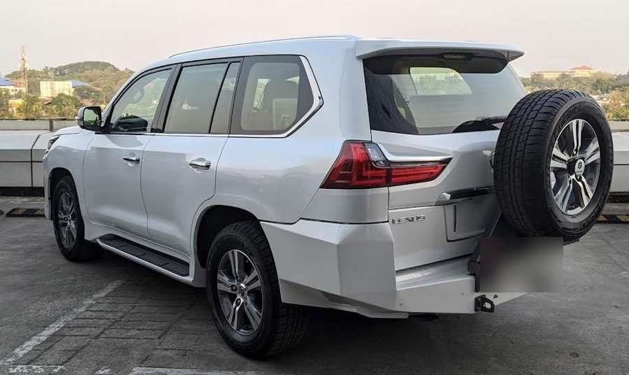 |

As far as we knew, this was the only kit of its kind for the LX570 in India. It was delivered to the client after quality checks and commissioning.

## Phase III: LMS Lexus Mobile Showroom

A 40 ft container showroom on a flatbed trailer pulled by a Bharat Benz 4023T, used to take Lexus cars to customers across Kerala, where luxury buyers are spread out and there was only one Lexus showroom in the state.

- **Side walls extend 1 m** on rollers and guides to enlarge the floor when parked
- **3 linear actuators**, 24 V, 3200 N, 1 m stroke
- **20 kVA (16 kW) 3 phase prime genset** powering AC, lighting, TV, fridge, coffee machine and actuators, with the load balanced across phases
- Auxiliary battery with state of charge monitoring, so the actuators always have power to retract

| Concept render | Extended floor plan | Container under construction |
|---|---|---|
| 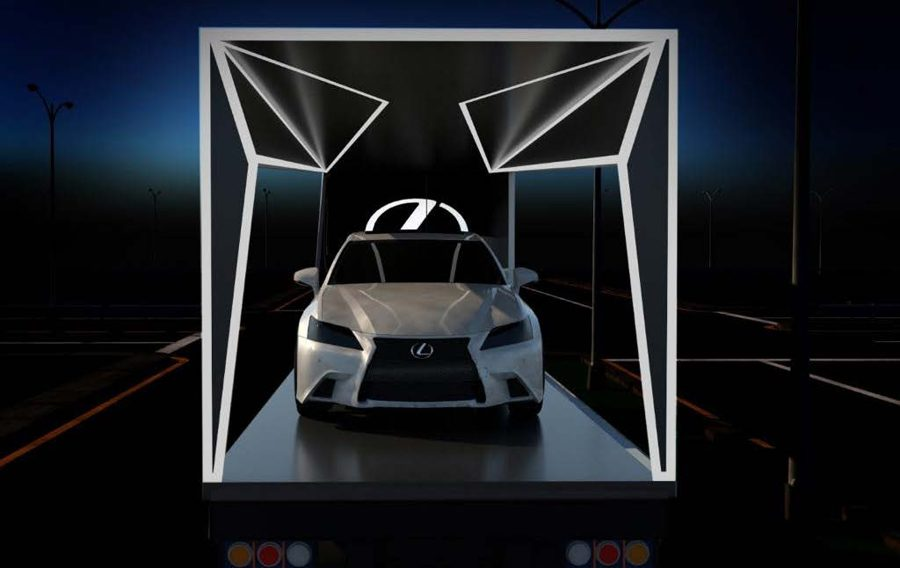 | 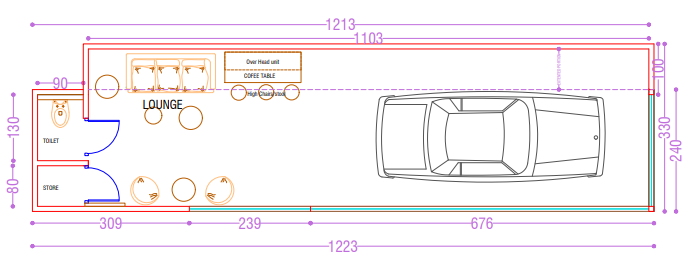 | 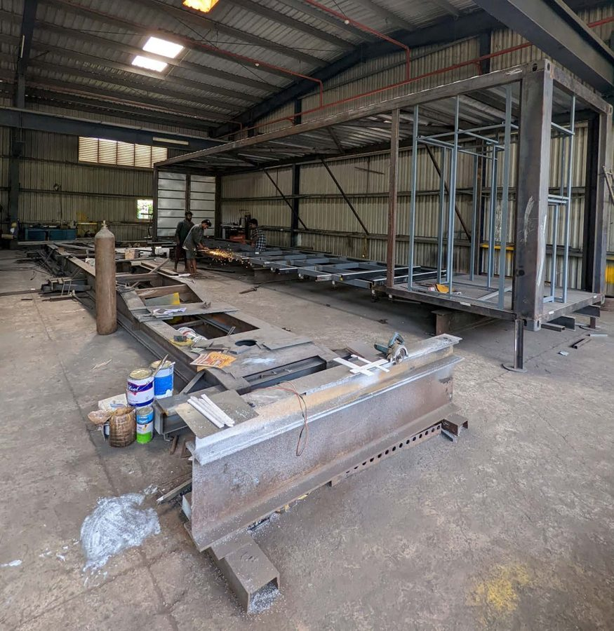 |

Walkthrough of the concept model, from the trailer outside to the car on display inside:

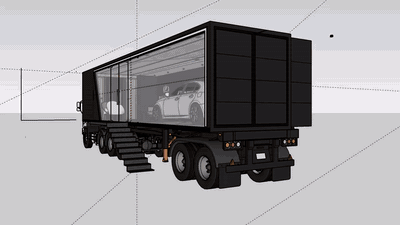

### Closed loop actuator control (my main task)

The first plan used plain relays, but with **no position feedback** the actuators could drift out of sync and rack the wall. I designed a closed loop alternative. Each actuator's position comes from Hall effect encoder feedback, and a PID loop drives it to the target. I also compared other options: potentiometer feedback, and CAN bus (SAE J1939) actuators with built-in controllers.

I prototyped it with two encoder motors standing in for the actuators, and **tuned the PID by trial and error** over 12 runs (P only, then PI, then PID):

| Start: Kp=10, Ki=5, Kd=5 (oscillates) | Tuned: Kp=5, Ki=20, Kd=10 | Check at a new setpoint (245) |
|---|---|---|
| 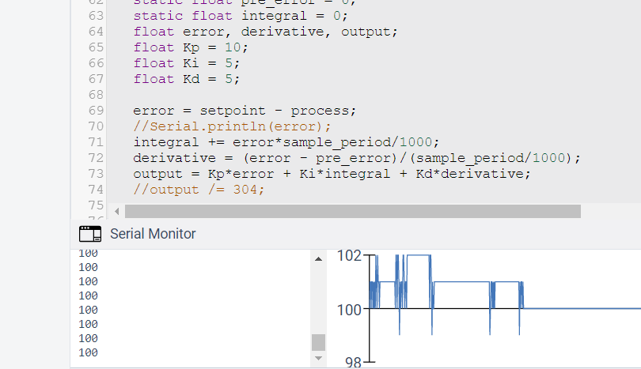 | 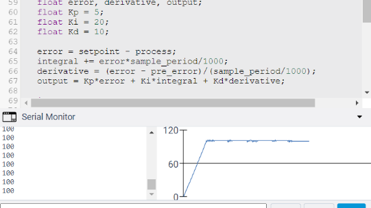 | 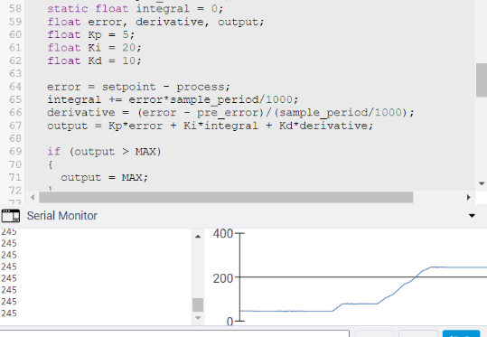 |

The controller firmware uses quadrature encoder feedback, a PID loop per actuator and a sync term that keeps the wall level, verified in simulation (see [Controller firmware](#controller-firmware) below). Code: [`firmware/lms_pid_actuator_prototype`](firmware/lms_pid_actuator_prototype/lms_pid_actuator_prototype.ino)

| PID loop logic | Actuator wiring | Power flow |
|---|---|---|
| 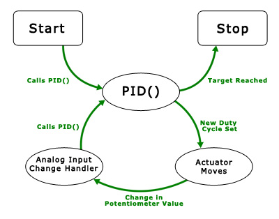 | 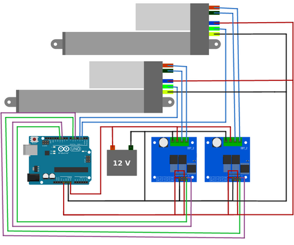 | 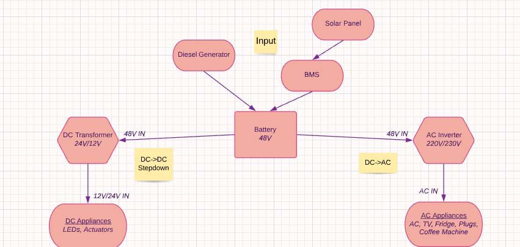 |

Fabrication delays meant the full LMS wasn't finished by the thesis deadline, so results are from the prototype.

## Skills used

Automotive wiring and harness work · ECU diagnostics (Toyota Techstream, OBD-II) · Arduino and embedded C · PID control and tuning · Fusion 360 CAD, rendering and stress simulation · material and corrosion selection · power system load planning · project scheduling, vendor and procurement management · testing, commissioning and quality checks

## Controller firmware

**LMS PID actuator controller** ([`firmware/lms_pid_actuator_prototype`](firmware/lms_pid_actuator_prototype/lms_pid_actuator_prototype.ino))

| Area | Design | Benefit |
|---|---|---|
| PID output | Signed −255…255 PWM command per motor | Proportional speed and direction control |
| Encoder feedback | Every pulse counted in the interrupt, with quadrature (channel A + B) direction sensing | Accurate position, even when the motor coasts or reverses |
| Serial input | Non-blocking line reader that ignores empty lines | A stray Enter never changes the target |
| Stop zone | Deadband checked first | Motor stops cleanly at the target |
| Timing | Fixed 20 ms (50 Hz) control loop on `millis()`, with the real dt in the maths | Consistent integral and derivative behaviour |
| Integral | Anti-windup (integrate only while not saturated) | Less overshoot after long moves |
| Pin map | Encoders on interrupt pins 2/3 (channel B on 4/7), motors on PWM pins 5/6 and 10/11 | No clash with Serial; speed control on both motors |
| Actuator sync | Separate PID per actuator plus a sync term that slows whichever is ahead | Keeps the showroom wall level while it extends |

**Verification**
- **Compiled** for Arduino Uno and Mega 2560 with `-Wall -Wextra`: zero warnings.
- **Automated tests:** the firmware runs unchanged against a mocked Arduino API and a modelled DC motor with quadrature encoder (`test/run_tests.sh`).

| Test | Result |
|---|---|
| Move to 100° | Within 1.1°, settled in 0.35 s, 4° overshoot |
| Reverse to −90° | Within 1.0°, settled in 0.87 s |
| Blank line in Serial Monitor | Ignored, position held |
| Motor 2 15% weaker than motor 1 | Max 6.5° apart during the move (39° without sync) |

The test motor model is generic, so the tests confirm the control logic. The gains (Kp 4, Ki 1.5, Kd 0.25) are starting values to tune on the real actuators.

**Project X control sketch** ([`firmware/px_merged_test`](firmware/px_merged_test/px_merged_test.ino))
- Fully non-blocking. Lights, motors, LEDs and Bluetooth all run together on `millis()` timers, so commands respond instantly.
- RGB commands are range checked (0–255) and bad input is rejected.
- `#R,G,B#` sets a custom ambient colour and `#RAINBOW#` goes back to the colour fade.
- **Tested:** colours apply the instant a command arrives, invalid input is rejected, and the motor cycle runs in the right order.

## Repo layout

```
firmware/
  px_merged_test/               Project X lights, motors and RGB ambient lighting
  lms_pid_actuator_prototype/   LMS PID position control with actuator sync
test/                           host simulation tests (run_tests.sh)
media/                          photos, renders, diagrams and tuning plots
docs/poster.jpg                 thesis poster
```

## Acknowledgements

Supervised by Dr Usha Rani S (SENSE, VIT Vellore) and on-site project director Mr Saghil Sali, Autostarke Pvt Ltd. Projects delivered for Lexus Kerala. Full thesis available on request.
